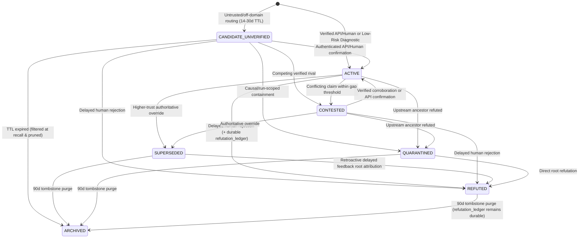

# Architecture & Design Rationale — Agentic Memory for Headless Agents

This document details the engineering reasoning, enforceable invariants, state machine, deployment boundary, and exact implementation mapping across all 10 operational constraints (PDF §3) and all 11 required architectural mechanisms (PDF §4).

---

## 1. Operational Constraints Mapping (PDF §3)

| Constraint | Requirement | Implementation & Measured Prototype Result |
|---|---|---|
| Black-Box Agent | No fine-tuning or weight updates | Prompt-injected context (`<= 3,600` soft-cap / `4,000` hard limit) + mandatory default-deny `ToolGateway` + blind `LLMClient.decide_next_action` |
| Workload | ~5,000 tasks/day, 2–50 tool calls (~20 LLM calls) | Multi-step `HeadlessAgentRunner` with `RunSessionContext` caching & `<= 2` bounded incremental refreshes |
| Multi-Tenancy | 200 orgs, 1 org/task, zero cross-org leakage | Partitioned `tenant_id` key across `memories`, `evidence_sources`, `run_reads`, `refutation_ledger`; tested across 200 orgs |
| Sparse Humans | ~2% delayed feedback days later; 98% unsupervised | `ingest_delayed_feedback`: approvals update utility; rejections bound attribution strictly to that run's read/created IDs + BFS quarantine |
| Untrusted Inputs | Emails, web pages, uploads, tickets | Attested `SourceAuthorityRegistry` (`connector_id` seal), injection rejection, `CANDIDATE_UNVERIFIED` staging (14–30d TTL enforced at recall), mandatory `ToolGateway` |
| Concurrency | Parallel workers updating same slot simultaneously | SQLite WAL + `BEGIN IMMEDIATE` + partial unique single-active slot index + `version` CAS + `evidence_sources` dedup |
| Context Budget | `<= 4,000` tokens/step | `TokenCounter` (optional HF `tokenizers` JSON or conservative BPE upper bound) + `3,600`-token soft-cap (`max_tokens_observed = 3,566`) |
| 2+ Year Lifetime | Strictly bounded storage growth | Ephemeral `TASK` discard, `<= 500` active/org + `<= 100` anti-memory caps, durable `refutation_ledger`, 30d/90d/180d compaction + rollups (`8.66 MB` / `5,053` memories at day 730 on the simulated 20-org workload) |
| Cost Budget | `<= 2.0` avg extra LLM calls/run (incl. background) | SQLite-persisted `llm_cost_events` across processes + retry tracking + circuit-breaker (`0.2022` memory LLM calls/run in offline persisted accounting with the simulated client, not live billing) |
| Latency Budget | `<= 300 ms` at p95 on critical path | Zero-LLM, zero-write-lock critical path on single-host SQLite WAL (`99.9 ms` `cold_connection_pass` p95, `92.7 ms` warm p95 across 8 OS workers on 62,043 mixed-status rows) |

---

## 2. Explicit Epistemic State Machine (`policy.py:VALID_STATUS_TRANSITIONS`, `store.py:_update_claim_row`)

Every persisted status mutation in `SQLiteMemoryStore._update_claim_row` enforces `assert_valid_status_transition(old_status, new_status)`:

---

## 3. Single-Host SQLite WAL vs. Multi-Host Postgres Deployment Boundary (`MemoryStoreProtocol`)

**Status:** `SQLiteMemoryStore` is the only implemented backend. The Postgres mapping below is a design for a future adapter; it has not been built or measured.

- **Prototype Scope (Measured Here):** Single-host local SQLite WAL (`PRAGMA journal_mode = WAL`, `busy_timeout = 15000`, `BEGIN IMMEDIATE` serialization, FTS5 global index) handles 8 concurrent OS processes on one machine cleanly across 62,043 mixed-status rows (`cold_connection_pass` reopens SQLite connections per run with uncached SQLite page cache while OS filesystem cache remains warm).
- **Storage Contract (`MemoryStoreProtocol`):** `EpistemicMemoryLayer`, `CostLedger`, `ToolGateway`, and `HeadlessAgentRunner` depend solely on the `@runtime_checkable` `MemoryStoreProtocol` (`src/agentic_memory/store_protocol.py`), cleanly isolating persistence mechanics from policy and epistemic recall.
- **Multi-Host Postgres Mapping (future adapter):** SQLite WAL cannot coordinate writes across separate pods/VMs or NFS mounts. A PostgreSQL adapter behind `MemoryStoreProtocol` should leave `EpistemicMemoryLayer`, `policy.py` and `ToolGateway` unchanged; the intended mapping is:
  - *Slot uniqueness & write locks:* SQLite `BEGIN IMMEDIATE` + Python conflict serialization -> Postgres `BEGIN` + `pg_advisory_xact_lock(hashtext(slot_key))` (or `SELECT ... FOR UPDATE`) backed by partial unique index `UNIQUE (tenant_id, slot_key) WHERE status = 'ACTIVE' AND cardinality = 'single'`.
  - *Cross-org atomic promotion:* SQLite `promote_global_cluster` inside `BEGIN IMMEDIATE` -> Postgres `INSERT ... ON CONFLICT DO UPDATE` / transactional `global_staging` check enforcing `COUNT(DISTINCT org_hmac) >= K`, `COUNT(DISTINCT origin_fingerprint) >= max(3, K-1)`, and `COUNT(DISTINCT source_hash) >= K`.
  - *FTS & vector recall:* SQLite FTS5 `memories_fts` -> Postgres `GIN` `tsvector` (+ optional `pgvector` HNSW cosine pre-filter) with row-level `tenant_id` / `user_id` predicates pushed into the query plan.
  - *Retention & rollups:* SQLite `compact_and_forget` atomic rollups into `daily_cohort_rollups`, `daily_cost_rollups`, and `promoted_cluster_counts` -> scheduled `pg_cron` / worker job using partitioned retention windows (`30d` payload redaction, `90d` `runs` / `llm_cost_events`, `180d` audits / promoted staging) and row-level security (`ENABLE ROW LEVEL SECURITY` on `tenant_id`).

---

## 4. Detailed Coverage of All 11 Architectural Mechanisms (PDF §4)

### 4.1 Write Policy (`policy.py`, `memory_layer.py`, `llm_client.py`)
- **Off-Critical-Path Extraction:** Runs in `end_run`. Structured tool outputs (`structured_facts`) parse deterministically (`0` LLM calls). Unstructured text passes a **structural + novelty salience gate** (`_is_salient_text` — checks technical/contact/numeric/error identifiers and novel predicate-bearing prose while skipping short/boilerplate acknowledgments, guarded by a fleet-wide LLM budget ceiling) before invoking `<= 1` `extract_claims` call.
- **Fail-Closed Extractor Grounding (`OpenAICompatibleLLMClient`):** Claims missing a valid observation `source_id` or failing observation span/value grounding (`_is_claim_grounded_in_observation`) are dropped; missing/downgraded `risk_class` on emails, non-public URLs, or routing predicates fail closed to `RiskClass.HIGH_ACTION_ROUTING`.
- **Deliberately Rejected:** `Scope.TASK` scratchpads (`EPHEMERAL_TASK_ONLY`), `< 8` or `> 480` char dumps (`REJECT_LOW_VALUE`), prompt injections (`REJECT_INJECTION`), and duplicate `source_id` replays (`DEDUPLICATED_SOURCE`).

### 4.2 Representation (`models.py:MemoryClaim`, `ClaimTransition`)
Typed, slot-addressed claims with `memory_id`, `tenant_id`, `scope`, `user_id`, `task_id`, `claim_type`, canonical `slot_key`, `subject`, `predicate`, `value`, `value_hash`, `statement`, `cardinality`, `volatility`, `risk_class`, `trust_tier`, `status`, `base_confidence`, `evidence_count`, `derived_from_ids`, `created_in_run_id`, `source_type`, `source_id`, `source_domain`, `version`, `expires_at`, and utility counters.

### 4.3 Trust, Provenance & Default-Deny Execution (`SourceAuthorityRegistry`, `ToolGateway`)
- **Immutable Server-Side Attested Trust (`SourceAuthorityRegistry`):** Trust tier (`1..6`) is resolved strictly by server-side connector attestation (`TOOL_TO_CONNECTOR`, HMAC `authority_seal`). Missing, unregistered, or unattested `connector_id` values fail closed to `TrustTier.UNTRUSTED_EXTERNAL` (`1`), never trusting caller-supplied `source_type` or `trust_tier` payloads. `ToolGateway.execute` ignores caller trust hints and stamps server-attested connector provenance.
- **Default-Deny `ToolGateway` (`policy.py:TOOL_CAPABILITIES`, `agent_runner.py:ToolGateway`):** Every tool call unconditionally passes `ToolGateway.execute(...) -> authorize_tool_action` (no bypass flags):
  - Unregistered tools fail closed (`blocked_unknown_tool_capability_default_deny`).
  - Registered `READ` tools pass immediately.
  - `INTERNAL_WRITE` permits internal writes lacking external targets while still enforcing anti-memory blocks.
  - `EXTERNAL_WRITE` and `CONFIG_WRITE` fail closed when untargeted (`blocked_missing_verifiable_external_target` / `blocked_unverified_config_write_fail_closed`) unless explicitly backed by `ACTIVE` `INTERNAL_API_VERIFIED` / `HUMAN_VERIFIED` memory, and verify active anti-memories (`refutation_ledger`) and tenant domain allowlists.

### 4.4 Revision (`policy.py:claim_freshness`, `claim_actionability`, `store.py:upsert_claim`)
- Confidence, freshness and actionability are separate (see §6.2). Confidence reflects evidence quality and
  contradiction hits (`0.65^k`) and does not decay with time. A separate time-decayed score (`effective_confidence`) is used only to rank recall.
- `CANDIDATE_UNVERIFIED` routing claims never promote via `UNTRUSTED_EXTERNAL` repetition (`<= 0.25` cap) and require `>= INTERNAL_API_VERIFIED` confirmation on `HIGH_ACTION_ROUTING`.
- Authoritative verified observations supersede older beliefs (`SUPERSEDED`); fresh diagnostic signatures against stale facts mark `CONTESTED` with `working_hypothesis=True`; ambiguous close-confidence conflicts (`|delta| < 0.15`) invoke `<= 1` off-critical-path adjudication call subject to the rolling `1.85` circuit-breaker.

### 4.5 Error Containment (`store.py:refute_and_contain`, `memory_layer.py:ingest_delayed_feedback`)
- Delayed rejection constrains `attribute_feedback_root` (one bounded LLM call) to claims recalled or created in `feedback.run_id`, so a hallucinated root ID cannot touch unrelated memories.
- Two relations are kept apart: `memory_derivations` (`derived_from`, declared at write time and filtered to what the run actually read) and `run_reads` (exposure). Exposure is not treated as causal dependence. Details in §6.1.
- Known boundary: a derivation that was never declared and shares no subject or entity with the root is not guessed at; it can only be caught when its own report is reviewed.

### 4.6 Scope & Two-Stage Cross-Tenant Isolation (`sanitize_for_global`, `promote_global_cluster`)
- Per-task (ephemeral), per-user (`(tenant_id, user_id)`), per-org (`tenant_id`), and `Scope.GLOBAL` (`__global__`). Direct `Scope.GLOBAL` writes in `upsert_claim` fail with `WriteOutcome.REJECTED_GLOBAL_BYPASS`.
- Stage 1 requires `trust_tier >= TOOL_OBSERVED`, non-external provenance, and `RiskClass.LOW_DIAGNOSTIC`.
- Stage 2 scrubs **all exported fields** (`statement`, `value`, `artifact_name`, `error_signature`, `cluster_key`) against tenant aliases, emails, IPs, private domains, local paths, secrets, and unsafe bypasses (`verify=False`), staging under versioned `HMAC(secret, org_id)` (`MEMORY_ORG_HMAC_SECRET` required in strict mode; DB-local random 32-byte key in dev mode). `promote_global_cluster` is the sole `Scope.GLOBAL` writer and enforces `K >= 5` distinct `org_hmac`, `>= max(3, K-1)` distinct `origin_fingerprint`, and `>= K` distinct `source_hash` inside `BEGIN IMMEDIATE`.

### 4.7 Critical-Path Recall (`memory_layer.py:_score_and_pack_rows`, `store.py:query_recall_rows`)
- Zero-LLM, zero-write-lock read enforcing recall-time TTL expiration (`expires_at > now`) before compaction runs.
- Exact boundary-safe subject + IDF-weighted lexical + decayed confidence scoring (`contested_pool` sorted relevance-first `(rel, eff_conf)`) packs four buckets (`negative_constraints`, `active_org`, `contested_unverified`, `global_advisories`) inside `PACKING_SOFT_CAP_TOKENS = 3,600` (`400`-token margin under `MAX_CONTEXT_TOKENS = 4,000`), achieving `1.0` `active_mrr` (`1.0` `active_hit_at_5`, `1.0` `anti_memory_surface_rate`, `1.0` `contested_framing_rate`, `1.0` `candidate_quarantine_rate`) and `0` forbidden-status/expired leaks across 200 queries on 62,043 mixed-status rows.

### 4.8 Bounded Forgetting & Durable Refutations (`store.py:compact_and_forget`, `refutation_ledger`)
- Zero-LLM compaction expires TTL candidates, caps `memories` (`<= 500` active/org, `<= 100` anti-memory rows/org, `<= 2,000` global advisories), redacts `runs` payloads after 30d, and atomically rolls up aged `runs` (> 90d -> `daily_cohort_rollups`), `llm_cost_events` (> 90d -> `daily_cost_rollups`), and promoted `global_staging` (> 180d -> `promoted_cluster_counts`) alongside pruning 60d `run_reads`, 90d tombstones, and 180d `containment_audits`.
- Even when >100 negative constraints trigger table eviction in `memories`, `refutation_ledger` preserves every human refutation permanently—blocking both re-learning in `upsert_claim` and tool execution in `ToolGateway`.

### 4.9 Concurrency (`store.py:SQLiteMemoryStore`)
- WAL mode + `BEGIN IMMEDIATE` backoff retries + partial unique single-active slot index + CAS `version` check + `evidence_sources` PK deduplication.

### 4.10 Measurement & Honest Experimental Scope (`experiment.py`, `eval/run_live_eval.py`)
- Proposed production evaluation (see the brief): tenants stratified by volume and task mix and assigned 1:1:1 to stateless, similarity-RAG and memory (about 67 tenants and 11,700 tasks per arm over one week), same model, prompts, tools, permissions and gateway; 200 blind-graded outputs per arm against hidden checks with Wilson intervals; plus false-memory use, authoritative contradictions, contamination left after correction, cross-tenant leaks, unsafe actions, tool calls, memory calls and p95 latency. This allocation is a proposal; the code implements the offline three-arm harness, not live allocation.
- `HeadlessAgentRunner` runs a blind multi-step `LLMClient.decide_next_action` loop against an encapsulated `_ToolEnvironment` (zero ground-truth peeking). `eval/run_live_eval.py` cleanly separates `fixture_validator_regression` (`measures_extractor_f1: false` in `--mode offline`) from `blind_agent_loop_eval` (`--mode offline|ollama|openai`).

### 4.11 Cost & Latency Accounting (`llm_client.py:CostLedger`, `store.py:llm_cost_events`)
- Every LLM API attempt (including transient retries and background maintenance) persists to `llm_cost_events` across OS worker processes (`worker_pid`, `attempt_num`, `tokens_in`, `tokens_out`, `succeeded`, `distinct_worker_pids = 2` verified in `multiprocess_cost_verification`).
- Measured prototype totals (`benchmarks/results.json`): **`0.2022` avg persisted memory LLM calls/run** (`<= 2.0`), **`99.9 ms` `cold_connection_pass` / `92.7 ms` warm p95** cumulative run critical-path latency (`<= 300 ms`).

---

## 5. Post-Gemini Review Hardening (Nov 2026)

This section maps each review item to the mechanism that addresses it. Measured results and caveats are in
[REVIEW_RESPONSE.md](REVIEW_RESPONSE.md).

### 5.1 Extraction → scope → admission are separate decisions
1. **LLM extraction** (`OpenAICompatibleLLMClient.extract_claims`). The model returns atomic claims, each
   with `source_id`, its own `source_quote` and a `suggested_durability`. It never sets trust, global
   scope or anti-memories.
2. **Deterministic validation** (`extraction_policy`, 0 LLM calls), applied to each claim:
   - the claim must be grounded in its observation;
   - its value literals must sit in its own quote;
   - its predicate and value types must match.
   Claims are accepted or dropped one at a time. A coverage-gap pass may trigger **one** focused
   re-extraction, and only for partly covered observations.
3. **Deterministic scope** (`classify_scope`). Explicit ephemerality comes first, then durable-org evidence,
   then the model's suggestion, then `TASK`.
4. **Admission** (`evaluate_candidate_write`, unchanged in authority). Trust caps, routing staging and
   injection rejection still apply. Injection rejection now checks the statement, the exact evidence quote
   and the source observation.

### 5.2 Measurement
- `evaluation.EvaluationOutcome` separates `correct_admission`, `correct_rejection`, `safe_abstention`,
  `false_rejection`, `under_admission`, `unsafe_admission`, `over_retention` and `api_unavailable`.
- Every rate is reported with a Wilson 95% CI.
- Claim-level labels (`expected_claims`) measure compound-fact recall.
- `eval/run_three_arm.py` scores final answers against hidden assertions (`grade_run`) and reports paired
  McNemar tests, so "safer but wrong" counts as wrong.

### 5.3 Global sharing bound to evidence
- `global_staging` now stores each contributor's `sanitized_value` and an `evidence_fingerprint`.
  - The fingerprint is an upstream-reference hash when the evidence cites a document, or a per-tenant
    execution hash otherwise.
- `promote_global_cluster` requires, inside `BEGIN IMMEDIATE`:
  - ≥K org HMACs;
  - ≥max(3, K−1) origins and ≥max(3, K−1) evidence fingerprints;
  - ≥K source hashes;
  - a value that ≥K contributors staged;
  - a statement whose literals all exist in the staged evidence (otherwise a deterministic template is used).
- Global rejections are counted per distinct rejecting org HMAC.

### 5.4 Attestation, tenancy, external actions
- **Attestation.** `SourceAuthorityRegistry` seals are `kid:HMAC`, using a shared key ring
  (`MEMORY_ATTESTATION_KEYS` / `MEMORY_ATTESTATION_SECRET`). `from_environment(strict=True)` refuses
  per-process random keys.
- **Tenancy.** Resource-level store methods take `tenant_id`, and request paths always pass it. Cross-tenant
  `run_id` overwrites, foreign `run_reads`, foreign counter updates and foreign `corrected_slot_key`
  feedback are all refused.
- **External actions.**
  - `TOOL_TARGET_KINDS` sets each tool's target contract: email, `https://` URL or route token.
  - `ToolGateway` reserves every external/config write in `tool_action_ledger`, keyed by tenant, task, tool
    and canonical args, before the handler runs.
  - Duplicates are suppressed; a failed action may be retried.
- **Gateway parity.** In-run verification from attested internal tools is applied in every experiment arm,
  so the gateway is identical across arms. Durable refutations are memory, so only the memory arm gets them.

## 6. Second Review Round (Nov 2026)

### 6.1 Containment: derivation vs exposure
When a human rejects a report, `ingest_delayed_feedback` retrieves the memories exposed to that run, makes one
bounded attribution call, and `refute_and_contain` then:
1. refutes the attributed root (`REFUTED`, anti-memory, `refutation_ledger` entry);
2. walks declared `derived_from` descendants. A descendant whose own evidence is CRM/API/human-verified keeps
   `ACTIVE` with the severed parent recorded; one that also has a clean verified parent becomes `CONTESTED`;
   the rest are `QUARANTINED`;
3. finds runs that read the root or a quarantined/contested descendant. Claims those runs created that are
   below internal-API trust and semantically related to the root become `CONTESTED` with
   `requires_verification`. They are not quarantined, because reading a memory does not prove the claim came from it;
4. records every affected run in `report_review_flags` so the reports can be re-checked.

### 6.2 Confidence, freshness, actionability
| Dimension | Meaning | Where |
|---|---|---|
| Confidence | Quality of the evidence (trust tier, corroboration, contradictions). No time decay. | `evidence_confidence` |
| Freshness | Days since last confirmation vs a revalidation window = min(risk window, volatility window). Risk: routing 30d, operational 90d, diagnostic 180d. Volatility: high 14d, medium 60d, low 365d. | `claim_freshness` |
| Actionability | Whether a claim may be used as context, stated as fact, or authorise an action. Stale or flagged claims are context only. | `claim_actionability` |

Stale `ACTIVE` claims are recalled with a `STALE-REVALIDATE` tag and a verification request. At the gateway, a
stale verified claim neither supports nor vetoes an action, and an in-allowlist email that matches a stale
routing memory is blocked until it is re-confirmed in the run.

### 6.3 Global semantics (`global_semantics.py`)
Before promotion: the value must be supported by staged evidence; contributors must not disagree in polarity on
the same object or pin different versions; and the synthesised statement must keep the evidence's polarity and
version constraints (negation, antonyms such as close/leave open, unsupported directives or versions). If the
synthesis fails these checks a deterministic template is used, and `statement_source` records why.

### 6.4 Attestation binding
Seals sign connector, source type, source id, external/origin flags, `tenant_id`, `run_id` and the SHA-256 of the
content. Verification fails closed when any of these is missing and requires exact equality with the expected
tenant and run, so a seal copied to another tenant, run or edited payload is rejected.

### 6.5 Evaluation design
All core arms (memory, stateless, naive RAG) run behind the same `ToolGateway`. Two optional arms isolate
components: naive RAG without the gateway (retrieval only), and memory without staleness labels in recall.
Mechanism benchmarks (`benchmarks/results.json`) and agent efficacy (`eval/results/three_arm_offline.json`) are
reported separately. The offline agent is a simulated client written alongside this code, so offline results
check the harness and the mechanisms, not model behaviour.
