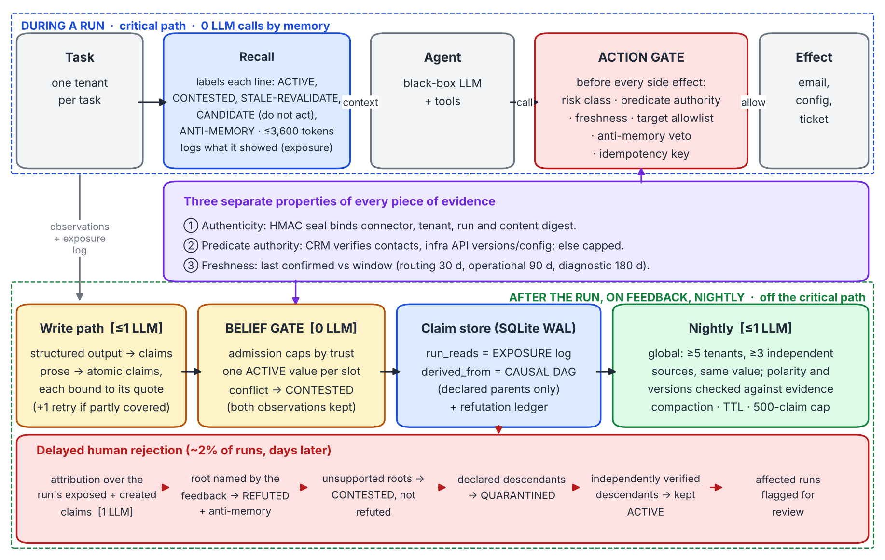
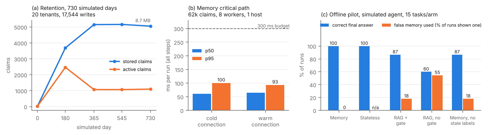

# Agentic Memory for Headless Agents

InteligenAI challenge · IIT (BHU) 2027

## 1. Thesis

Memory is a tenant-scoped belief state whose admission and revision depend on evidence, while a separate risk-aware action gate decides what the agent may do with each belief, because permission to recall is not permission to act.

## 2. Hardest sub-problem

**Error containment.** A wrong belief is found days later, after other runs have used it. Two records keep this tractable: *run_reads* logs which memories each run was shown (exposure), and *derived_from* stores declared parent claims (causation). Exposure is not cause. Attribution proposes roots from the rejected run’s exposed and created claims; only roots the feedback supports are refuted. Unsupported candidates become contested, not quarantined. Declared descendants are quarantined unless independently verified, and affected runs are flagged. Sent actions cannot be undone.

## 3. Architecture

**Record.** One typed claim per slot (tenant, subject, predicate), e.g. acme | prod_db | engine_version = Postgres 14, with status, trust tier, risk class, scope, version and *last_confirmed_at*. Each evidence item carries connector, source id, tenant, run, observed time, an HMAC seal and a SHA-256 content digest.

*Figure 1. Belief gate, action gate, the two provenance relations and the feedback path. Square brackets give LLM calls by memory.*

**Trust is three properties, not one score.**

- **Authenticity:** the seal verifies for this tenant, run and content; a copied or edited seal fails closed to untrusted.
- **Predicate authority:** the CRM is authoritative for contacts, the infrastructure API for versions and configuration. Outside its domain a connector is capped at tool-observed. The same rule would cover email: DKIM proves the sender domain, not the contents.
- **Freshness:** days since last confirmation against a window of min(risk, volatility): routing 30 d, operational 90 d, diagnostic 180 d; volatility 14/60/365 d are defaults.

Confidence reflects evidence only and does not decay; actionability is computed at use time.

**Belief gate** (post-run, 0 LLM). One extraction call turns salient prose into atomic claims, each bound to its quote; a rule sets scope. Untrusted text becomes a 14-day candidate (routing capped at 0.25), single-run inferences cap at 0.48. Recall labels lines ACTIVE, CONTESTED, STALE-REVALIDATE, CANDIDATE or ANTI-MEMORY. Stale diagnostic facts appear as labelled hypotheses.

**Action gate** (critical path, 0 LLM). Before any side effect it checks risk class, current authority, freshness, target allowlist and anti-memory veto, and reserves an idempotency key. A candidate never authorises an action; a stale routing fact is blocked even on an allowlisted domain.

**Concurrency.** Writes run in SQLite *BEGIN IMMEDIATE* with a version check before each update and bounded, jittered retries (12). Two workers writing different values to one slot both persist; the slot becomes CONTESTED (tested).

**Sharing.** Only tool-verified public-library fixes, scrubbed, from five tenants and three independent sources staging the same value. Contributor disagreement, flipped polarity or an added version blocks promotion. K is a privacy filter, not proof of correctness.

**Forgetting.** At most 500 active claims and 100 anti-memories per tenant, a starting assumption to test against real workloads. Eviction ranks by confidence, access recency, verified helps, access count and trust; anti-memories and human-verified claims get bonuses, and refutations are kept permanently.

**Measured (single host, SQLite WAL, 8 workers, 62k claims).** Cumulative memory critical path per run: 100 ms p95 cold, 93 ms warm. Offline accounting: 0.20 memory LLM calls per run; my fleet estimate is 0.75 (60% of runs extract). Everything in this section is implemented and covered by the 84-test suite except DKIM handling and PostgreSQL, which are designed, not built.

## 4. Walkthroughs

**1. Staleness.** March: the infra API, authoritative for this predicate, records Postgres 14 [0 LLM]. By September it is past its 180-day window: still authentic, no longer fresh, so recall marks it STALE-REVALIDATE [0 LLM]. A PG16-only error becomes a diagnostic hypothesis [1 LLM] and both values are contested. Before operational use the agent queries the infra API; that current result alone supersedes PG14 [0 LLM].

**2. Planted memory.** The off-domain contact is extracted from an untrusted ticket [1 LLM] and kept only as a candidate. The CRM is the authority for contacts, so the action gate blocks the escalation and the agent queries the CRM [0 LLM]. An identical genuine update stays a candidate until the CRM or a reviewer confirms it.

**3. Compounding error.** The UTC guess enters capped at 0.48. Twelve later claims declare it as a parent; three only share its subject. A rejected report triggers one attribution [1 LLM] over that run’s exposed and created claims. The supported root is refuted and gets an anti-memory; the twelve are quarantined; the three are contested for re-checking; independently verified descendants stay active; the 40 affected runs are flagged [0 LLM]. Sent actions are not rolled back.

**4. Across tenants.** Yes. Each tenant keeps its own evidence. A scrubbed (library, error, fix) record is promoted after five tenants and three independent sources; one synthesis [1 LLM] is checked against staged evidence. Org 31 sees only the advisory. Residual risk: polarity checks are lexical, not full entailment.

## 5. How it fails

**Silent cross-subject contamination.** A run reads ‘Vendor Y returns UTC’ and writes an unrelated rule, ‘billing reconciliation window = 4 h’, without declaring a parent or sharing a subject token. When the UTC claim is refuted, the exposure log shows the rule was written in an exposed run, but it is not semantically related, so it stays ACTIVE. It is corrected only when its own output is rejected.

**Why I accept it.** Re-auditing every claim written in every exposed run would cost LLM calls outside the per-run budget and quarantine many correct claims. Recovery is therefore bounded, not complete: the flagged-run list gives reviewers the place to look.

## 6. Experiment

One week, 35,000 tasks. Tenants are stratified by volume and task mix and assigned 1:1:1 (about 67 tenants, 11,700 tasks per arm) to stateless, similarity-RAG and memory. Model, prompts, tools, permissions and gateway are identical; each tenant stays in one arm. A live 15-task pilot (the offline harness in Figure 2c, run against a real model) must pass first.

- **Correctness:** 200 blind-graded outputs per arm against hidden checks, with Wilson intervals; this detects about 11-point differences.
- **Also measured:** false-memory use, authoritative contradictions, contamination left after correction, cross-tenant leaks, unsafe actions, tool calls, memory calls, p95 latency.

*Figure 2. Prototype measurements from the canonical runs. (c) is a 15-task offline pilot with a simulated agent, not live evidence.*

**I am wrong if** memory does not beat RAG on audited correctness or repeated errors, falls below stateless beyond the interval, leaks across tenants, causes an unsafe action, or exceeds 2 calls/run or 300 ms p95.
